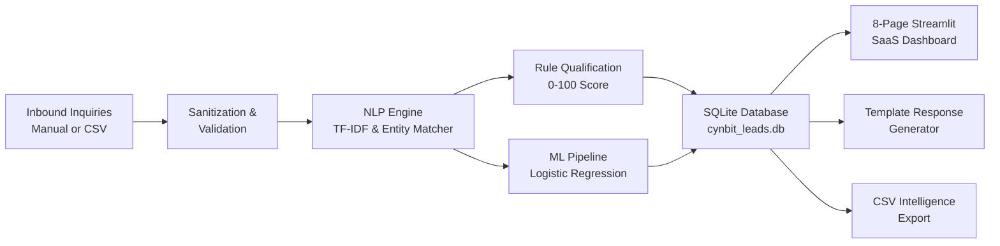

# Cynbit LeadIQ

**AI-Powered Lead Intelligence, Qualification and Conversion Prediction System**  
*A production-style MVP built for Cynbit's AI/ML Engineer assessment.*

---

## 📌 Executive Summary & Business Problem

For bespoke software engineering and applied AI consulting companies like **Cynbit**, incoming client inquiries vary dramatically in technical readiness, delivery urgency, and commercial viability. Technical directors and sales leads spend valuable hours manually sorting through vague messages, chasing low-budget requests, or writing repetitive preliminary scoping emails.

**Cynbit LeadIQ** solves this problem by automating the inbound evaluation lifecycle:
1. **Intelligent Ingestion:** Accepts inquiries via single-entry forms or batch CSV uploads with strict validation.
2. **Transparent NLP Extraction:** Cleans text, extracts key domain terms, and maps inquiries into core service categories (AI/ML Solutions, Web Development, Mobile Apps, Automation & Workflows, Cloud & DevOps).
3. **Explainable Rule-Based Qualification:** Evaluates requirements against a 0–100 deterministic scoring framework across 6 transparent dimensions, categorizing leads into **Hot**, **Warm**, and **Cold** tiers.
4. **Empirical ML Conversion Prediction:** Evaluates conversion likelihood using a trained Scikit-Learn pipeline (TF-IDF + ColumnTransformer + Logistic Regression) with feature attribution odds ratios.
5. **Deterministic Response Generation:** Generates customizable first-touch discovery emails without third-party LLMs or hallucinations.
6. **Lead Management & CRM Workflow:** Full SQLite persistence, searchable/filterable pipeline dashboard, status tracking, and CSV exports.

---

## 🛡️ Core Constraints & Design Principles

- **100% Offline & Local:** Requires zero paid APIs, zero cloud inference endpoints, and zero API keys (no Gemini, OpenAI, or Anthropic dependency).
- **Explainable & Auditable:** Clear distinction between policy-driven rule scoring and empirical statistical ML prediction.
- **Data Integrity:** Strict prevention of data leakage; all vectorizers and scalers are fitted strictly on training data.
- **Honest Claims:** All synthetic benchmark metrics are explicitly labeled. High synthetic performance is not conflated with real-world empirical conversion.

---

## 🏗️ Architecture & Technology Stack



- **Language:** Python 3.14+
- **Frontend / Dashboard:** Streamlit, Plotly Express
- **Machine Learning & NLP:** Scikit-Learn (`TfidfVectorizer`, `ColumnTransformer`, `LogisticRegression`), NumPy, Pandas
- **Persistence & Serialization:** SQLite3, Joblib, JSON
- **Validation & Testing:** Pydantic v2, Pytest

---

## 📂 Project Structure

```
cynbit-leadiq/
├── app.py                     # Streamlit multi-page web application
├── src/
│   ├── __init__.py
│   ├── config.py              # Configuration constants, paths, and thresholds
│   ├── schemas.py             # Pydantic data validation schemas
│   ├── preprocessing.py       # Text sanitization, normalization, and stopword filtering
│   ├── extraction.py          # TF-IDF keyword extraction & service categorization
│   ├── scoring.py             # Rule-based qualification engine (0-100 score)
│   ├── training.py            # Reproducible synthetic dataset generator & ML trainer
│   ├── prediction.py          # Inference engine & explainability interface
│   ├── response_generator.py  # Deterministic, template-based response generator
│   ├── database.py            # SQLite CRUD operations and parameterized queries
│   └── demo_data.py           # Preloaded synthetic benchmark leads
├── data/
│   ├── synthetic_leads.csv    # Sample leads for batch CSV intake testing
│   ├── training_dataset.csv   # Synthesized benchmark dataset with ground truth
│   └── cynbit_leads.db        # SQLite database (auto-generated on first launch)
├── models/
│   ├── conversion_pipeline.joblib # Saved Scikit-Learn pipeline artifact
│   └── model_metadata.json    # Model evaluation metrics & feature coefficients
├── reports/
│   ├── AI_Opportunity_Report.md     # Comparison of 5 AI opportunities for Cynbit
│   └── Technical_Approach_Report.md # Comprehensive engineering & architectural report
├── tests/
│   ├── test_preprocessing.py
│   ├── test_extraction.py
│   ├── test_scoring.py
│   ├── test_model_pipeline.py
│   ├── test_database.py
│   └── test_response_generator.py
├── screenshots/               # Demo screenshots and visual artifacts
├── requirements.txt
├── .gitignore
└── .env.example
```

---

## 🚀 Quickstart & Installation

### 1. Prerequisites
- Python 3.10+ (tested on Python 3.14)
- Existing virtual environment (e.g. `~/Desktop/ml/.venv`)

### 2. Install Dependencies
```bash
cd ~/Desktop/ml/cynbit-leadiq
~/Desktop/ml/.venv/bin/pip install -r requirements.txt
```

### 3. Train or Verify Model Artifacts
The repository includes a reproducible training script. To re-train from scratch:
```bash
~/Desktop/ml/.venv/bin/python src/training.py
```

### 4. Run the Streamlit Application
```bash
~/Desktop/ml/.venv/bin/streamlit run app.py
```
Open your browser at `http://localhost:8501`.

---

## 🧪 Running Automated Tests

A comprehensive test suite of 24 unit and integration tests verifies all components:
```bash
~/Desktop/ml/.venv/bin/pytest tests/ -v
```

Expected output:
```
tests/test_database.py ........ [ 20%]
tests/test_extraction.py ....... [ 45%]
tests/test_model_pipeline.py .. [ 55%]
tests/test_preprocessing.py .... [ 70%]
tests/test_response_generator.py ... [ 85%]
tests/test_scoring.py .......... [100%]
============================== 24 passed in 4.28s ==============================
```

---

## 🖥️ Application Walkthrough (8 Pages)

1. **Overview:** High-level operational KPIs (Total Leads, Hot Leads %, Mean Score, Mean Conversion Likelihood), interactive Plotly visualizations, and recent inquiry activity.
2. **Add Lead:** Single-lead intake form with real-time validation and evaluation preview, alongside a Batch CSV uploader supporting multi-record ingestion.
3. **Lead Intelligence:** Deep-dive analysis for any selected lead displaying raw vs. cleaned text, TF-IDF terms, recognized entities, category distribution, and a 6-factor score progress breakdown.
4. **Conversion Prediction:** Empirical ML conversion likelihood gauge, top positive/negative odds ratios, and the **Rule vs. ML Strategic Comparison Matrix**.
5. **Response Generator:** Tailored reply drafts based on service offering, urgency tier, and extracted scope. Strictly labeled as template-generated.
6. **Lead Management:** Searchable and filterable data grid with status updating, internal notes, deletion, and full CSV export.
7. **Model Evaluation:** Diagnostic report showing train/test split metrics, confusion matrix heatmap, and logistic regression feature coefficients.
8. **About & Methodology:** Strategic overview, Mermaid architecture diagram, and privacy/security guarantees.

---

## 📊 Benchmark Evaluation Metrics

Evaluated on a 20% holdout test partition (stratified, $N=90$):

| Metric | Score | Explanation |
| :--- | :---: | :--- |
| **Accuracy** | **88.89%** | Correct classification across both conversion classes |
| **Precision** | **96.15%** | Minimal false positive rate on conversion predictions |
| **Recall** | **86.21%** | Strong sensitivity in identifying viable opportunities |
| **F1 Score** | **90.91%** | Balanced harmonic mean |
| **ROC-AUC** | **0.9461** | High discriminative threshold power |

> **⚠️ Synthetic Benchmark Notice:** These metrics are derived from parametrically synthesized inquiry records with realistic feature distributions. High scores reflect model alignment with synthetic generative rules and should not be interpreted as guaranteed real-world enterprise conversion accuracy.

---

## 🔒 Security & Privacy Guarantees

- **No Data Egress:** All inquiries remain within the local SQLite database.
- **SQL Injection Prevention:** 100% of database interactions use parameterized queries.
- **Safe Serialization:** Model artifacts use Scikit-Learn standard formats with verified dependencies.

---

## 📈 Future Enhancements

1. **Active Learning Retraining Loop:** Ingest actual closed-won and closed-lost CRM outcomes to update logistic coefficients quarterly.
2. **Local Small Language Model (SLM) Integration:** Optional drop-in support for quantized local models (e.g., Llama 3 8B via llama.cpp or Ollama) for zero-cloud generative replies.
3. **CRM Webhook Integrations:** Bidirectional sync connectors for HubSpot, Salesforce, and Slack notifications.
