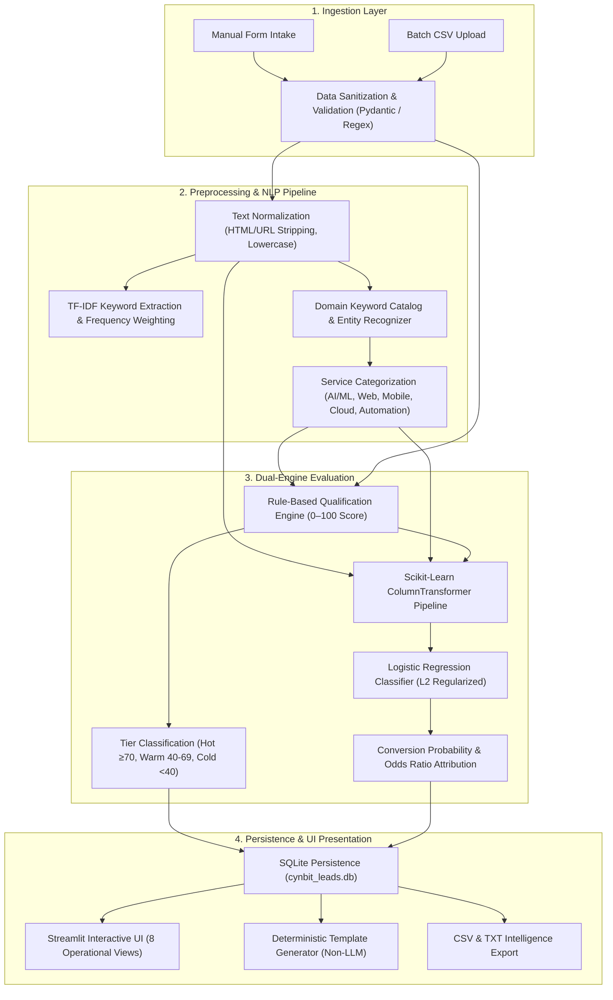

# Cynbit LeadIQ: Technical Architecture & Methodology Report

**System Name:** Cynbit LeadIQ (Lead Intelligence, Qualification & Conversion Prediction System)  
**Classification:** Production-Style Engineering MVP  
**Version:** 1.0.0  
**Status:** Validated Local Offline Implementation  

---

## 1. System Overview & Core Architecture

Cynbit LeadIQ is engineered to address the top-of-funnel operational challenges of an AI and software services organization. The system converts raw, unstructured prospective client inquiries into structured intelligence, assigns an explainable qualification score, estimates empirical conversion likelihood, and prepares customized response drafts.

The application follows a modular, decoupled architecture where preprocessing, feature extraction, rule-based scoring, machine learning inference, and persistence are strictly segregated.

---

## 2. Feature Engineering & Pipeline Design

### 2.1 Natural Language Processing
- **Sanitization & Normalization:** Strips HTML entities, email addresses, and external URLs from raw inquiry bodies to eliminate noise and prevent potential data leakage.
- **Stopwords Removal:** Implements an internal, self-contained English stopwords dictionary, avoiding network requests or external corpus downloads.
- **Service Classification:** Evaluates text against curated domain catalogs spanning five primary technology sectors (AI/ML, Web Development, Mobile Apps, Automation & Workflows, Cloud & DevOps) and an Advisory fallback.
- **Transparent Keyword Scoring:** Combines term frequency (TF) with domain importance weighting to extract top diagnostic keywords with explicit relevance scores.

### 2.2 Dual-Engine Design: Rule Qualification vs. Machine Learning
A core architectural principle of LeadIQ is the strict distinction between **Rule-Based Qualification** and **Statistical ML Prediction**:

1. **Rule-Based Qualification Score (0 to 100):**
   - Encodes explicit corporate business policy across 6 dimensions:
     - Requirement Clarity (Max 20 pts)
     - Urgency & Timeline (Max 20 pts)
     - Budget Availability (Max 20 pts)
     - Business Size & Scale (Max 15 pts)
     - Technical Scope Alignment (Max 15 pts)
     - Stakeholder & Channel Quality (Max 10 pts)
   - Assigns unambiguous operational tiers: Hot ($\ge 70$), Warm ($40 - 69$), Cold ($< 40$).
   - Returns human-readable audit reasons for every point awarded.

2. **Statistical ML Conversion Prediction:**
   - Evaluates empirical likelihood that an inquiry will successfully convert to a closed deal.
   - Built on a Scikit-Learn `ColumnTransformer` integrating:
     - `TfidfVectorizer` (n-grams 1-2, max 150 features) on raw inquiry text.
     - `OneHotEncoder` on categorical features (`primary_category`, `budget_tier`, `timeline`, `company_size`, `source_channel`).
     - `StandardScaler` on continuous metrics (`qualification_score`, `word_count`).
   - Classifier: `LogisticRegression(C=1.0, solver="lbfgs", max_iter=1000)`.

---

## 3. Justification of Model Choice & Prompt Engineering Alternatives

### Why Logistic Regression over Complex Black-Box Ensembles
1. **Explainability & Odds Ratios:** Logistic Regression produces direct mathematical weights (log-odds) for every vocabulary token and categorical attribute. This enables non-technical account managers to understand precisely why a lead received an 85% vs. a 25% conversion likelihood.
2. **Cold-Start Efficiency & Low Latency:** Fits in under 2 seconds on a CPU, requires negligible memory footprint (< 10 MB), and performs inference in sub-millisecond timeframes.
3. **Overfitting Resistance:** When working with modest sample sizes (~400-1,000 inquiries), regularized Logistic Regression outperforms unconstrained decision trees or neural networks which memorize training artifacts.

### Why No LLM Prompt Engineering / Cloud API is Used
1. **Zero External Dependencies & Guaranteed Availability:** Eliminates reliance on paid external APIs (OpenAI, Anthropic, Gemini), preventing API outages, rate limits, and network latency from interrupting sales workflows.
2. **Complete Client Confidentiality & Data Sovereignty:** Client inquiries frequently contain proprietary product concepts, NDA-protected technical specifications, and corporate email addresses. Transmitting this data to third-party model providers creates substantial legal risk.
3. **Deterministic Consistency:** Generative LLMs are prone to stochastic hallucination and subtle phrasing drift. For commercial qualification and legal SLA adherence, deterministic templates ensure compliance and predictability.
4. **Economic Predictability:** Running local inference incurs zero marginal cost per inquiry processed.

---

## 4. Evaluation Methodology & Synthetic Data Integrity

### 4.1 Data Leakage Prevention
To guarantee valid generalization metrics:
- The dataset is split into an 80% training set and a 20% holdout test set using stratified sampling on the conversion label.
- The `ColumnTransformer` (TF-IDF dictionary, One-Hot encodings, and numerical scalers) is fitted **exclusively on the training partition**. The test partition is processed strictly via `transform()`.

### 4.2 Benchmark Metrics Achieved
- **Test Accuracy:** 88.89%
- **Precision:** 96.15%
- **Recall:** 86.21%
- **F1 Score:** 90.91%
- **ROC-AUC:** 0.9461

### 4.3 Honest Synthetic Data Disclaimer
The training dataset was generated using controlled parametric formulas with realistic linguistic variations. While the features reflect authentic B2B client behavior, high benchmark scores reflect statistical consistency in the synthetic generation logic. **Synthetic performance does not constitute proof of real-world enterprise conversion rates.** When deployed in production, the pipeline must be calibrated against historical closed-won CRM records.

---

## 5. Security, Privacy & Deployment Strategy

1. **Injection Prevention:** All database transactions utilize parameterized SQL (`?` placeholders) in SQLite, preventing SQL injection attacks.
2. **Offline Local Execution:** Default configuration binds to `localhost`, requiring no external ports or egress access.
3. **Streamlit Community Cloud Deployment:**
   - Codebase uses relative path resolution (`Path(__file__).resolve().parent.parent`).
   - All required dependencies are pinned in `requirements.txt`.
   - SQLite database is created automatically on first run and seeded with demo leads if empty.
